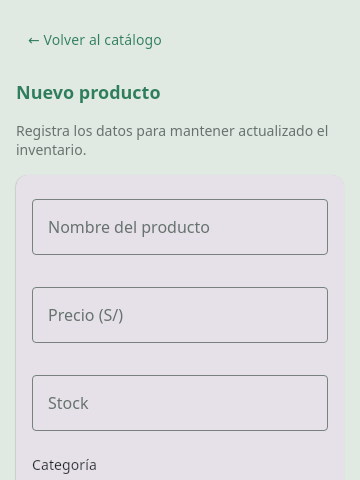
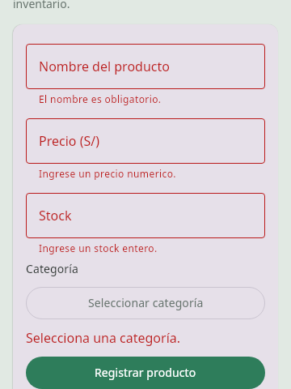
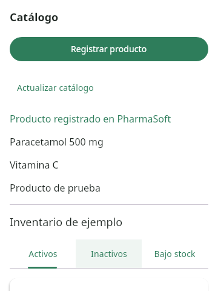

# Corrección de Productos — Desktop 0.2

El catálogo usa una sola lista desplazable. Registrar producto abre un formulario completo con desplazamiento vertical y categoría seleccionable. Inicio y login también se adaptan con desplazamiento a alturas reducidas.

Verificado con una prueba de interfaz en 360 × 480: desplazamiento táctil, validación de formulario vacío, acceso a todos los campos y botón, categoría, registro de un producto, regreso al catálogo y actualización del servidor simulado. Se comprobaron las capturas visualmente.

También pasaron las pruebas existentes de `shared:testAndroidHostTest` y `androidApp:assembleDebug`. El JAR se probó desde el ejecutable «Abrir PharmaMobil». No se usó un emulador Android ni el backend real en esta validación; la conexión real sigue requiriendo PharmaSoft y su base de datos.

